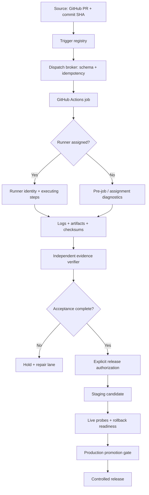
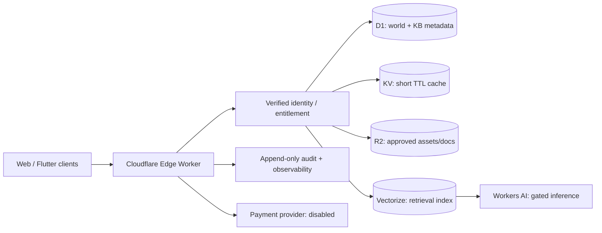

# LINGOlegacy Enterprise Platform Operations Matrix
**Revision:** 2026-11-01  
**Repository:** `thelingolegacy-blip/TheLingoLegacy`  
**Status:** design and source baseline; not a production acceptance record

## Executive operating rule

Operate one platform through distinct control planes. Do not turn an available integration, deployed preview, registered resource, or green UI indicator into a claim of production readiness.

`SOURCE → ACTUAL EXECUTION → RETRIEVABLE EVIDENCE → INDEPENDENT VERIFICATION → ACCEPTANCE → AUTHORIZATION → PROMOTION`

Production remains protected. Billing, secrets, DNS, route allocation, app-store submission, payment processing, AI activation, and release promotion are separate authorization gates. This document grants none of those permissions.

## 1. Priority order

| Priority | Workstream | Immediate outcome | Exit evidence |
|---|---|---|---|
| P0 | G02 / CI execution | Restore real workflow execution and runner assignment | Runner ID/name, executing steps, complete logs, artifacts, sentinel correlation |
| P0 | Security baseline | Protect sessions, rate limits, origins, consent, secrets, admin controls | Tests, config evidence, security review |
| P0 | Release integrity | Reconcile stacked PRs and fail-closed acceptance claims | Clean base, review, passing independent checks |
| P1 | Platform registry | Repair registry verifier; reconcile engine/world identities | Node syntax + registry tests + canonical IDs |
| P1 | Data plane | Stage D1 schema, KV/R2/AI contracts, migration and rollback | Local D1 migration tests; staging integration evidence |
| P1 | Flutter/Firebase | Replace placeholders through secure environment configuration | Registered Firebase app IDs, rules tests, Android/iOS build artifacts |
| P1 | Studio/AppDeploy | Fix recorded frontend errors; map 15 deployed surfaces to canonical products | Browser QA, asset checks, app-to-product registry |
| P2 | Domain | Resolve existing AppDeploy pending DNS registrations without disturbing Cloudflare routes | Plan eligibility, DNS ownership, record diff, independent verification |
| P2 | Mobile publishing | Register app identifiers and store accounts; prepare signed release candidates | Store validation, privacy/data-safety declarations, signed artifacts |
| P2 | Monetization | Keep demo-only economy; implement compliant checkout only after legal and payment gates | Provider webhook verification, refund/tax/support controls, approval |
| P3 | Growth and analytics | Funnels, referral attribution, campaign operations, content distribution | Consent-aware event taxonomy, retention and conversion baselines |

## 2. Platform responsibility matrix

| Layer | Canonical responsibility | Preferred implementation | Safe fallback | Current evidence / gate |
|---|---|---|---|---|
| Source control | Code, reviews, release manifests | GitHub | GitLab mirror only if configured | GitHub repo connected; PR stack needs reconciliation |
| CI / dispatch | Build, test, artifact production | GitHub Actions | Hosted runner while G02 recovery is unresolved | Do not infer execution from queued/startup-failure |
| G02 runner | Authorized execution and sentinel | `lingo-legacy-g02` self-hosted runner | GitHub-hosted build/test lanes where permitted | Host access and actual assignment remain unverified |
| Web frontend | Public product surfaces | Existing static web / React surfaces | AppDeploy isolated preview | 15 AppDeploy apps report deployed; deployment != release acceptance |
| Studio | Creative, operations, review intake | Existing LINGOlegacy Studio Hub | Master project-plan surface | Studio Hub reports ready; publishing/rights gates remain |
| Mobile | iOS / Android client | Flutter | Responsive web/PWA | Firebase options contain placeholders; store registration unverified |
| Identity | Authentication and account identity | Firebase Auth after project/app verification | Existing current identity service only | No new production identity binding authorized |
| Relational data | Authoritative world/content metadata | Cloudflare D1 | Local SQLite for tests | Separate world-engine D1 exists but has no app tables |
| Cache | Non-authoritative cache and short-lived flags | Cloudflare KV | In-memory local test cache | No production KV binding authorized |
| Object storage | Media, manifests, approved knowledge documents | Cloudflare R2 | Existing repository assets | R2 is not enabled in the inspected account |
| AI | Governed inference and retrieval | Workers AI + Vectorize; optional AI Gateway | Disabled deterministic fallback | AI remains off until model, cost, privacy and safety gates pass |
| Payments | Provider-hosted checkout and signed webhooks | Stripe, optional later | Demo-only credits / no checkout | Billing is disabled; no payment secrets or activation |
| Edge / routing | TLS, caching, rate limits, Worker routing | Cloudflare | AppDeploy preview hostnames | Existing production Workers/routes remain protected |
| Observability | Logs, traces, health, SLOs | Cloudflare observability + GitHub artifacts | Structured JSON logs | Need correlation IDs and durable evidence |
| Creative | Design, image, video, audio assets | Figma / Adobe / Canva / InVideo | Repository asset templates | Assets require provenance, rights and version registration |
| Publishing | Social and store distribution | Approved platform APIs / store portals | Exportable review package | Account authorization and publication approval absent |

## 3. Current platform inventory

### AppDeploy surfaces

The connected AppDeploy account returned 15 existing apps. All 15 report a deployed status. Status responses show no backend errors; this is not equivalent to end-to-end certification.

| Surface | Current URL | Finding |
|---|---|---|
| LINGOlegacy Studio Hub | https://lingo-legacy-studio-hub-nhda3b.v2.appdeploy.ai/ | Ready; validation warning: seven tests in suite |
| Master Project Plan | https://lingo-legacy-master-project-plan-rkh6r6.v2.appdeploy.ai/ | Ready; QA snapshot available |
| Main LINGOlegacy runtime | https://hello-the-lingo-legacy-ois1rj.v2.appdeploy.ai/ | Ready; health-monitor cron reports recent success |
| That's My Lingo | https://that-s-my-lingo-casino-studio-2xntye.v2.appdeploy.ai/ | Ready; demo game only; no real-money wagering |
| LINGO Universe | https://lingo-legacy-universe-rpekc0.v2.appdeploy.ai/ | Ready; demo-credit slot prototype |
| Studio Control | https://the-lingo-legacy-y67ewl.v2.appdeploy.ai/ | Ready; QA unverified by its own description |
| Design Studio | https://obsidian-closet-design-studio-zk6va7.v2.appdeploy.ai/ | Ready |
| Jersey Shore: The Undead | https://jersey-shore-the-undead-l4h5ea.v2.appdeploy.ai/ | Recorded CSS asset-load error |
| HQ | https://the-lingo-legacy-hq-vhjt6i.v2.appdeploy.ai/ | Ready; no current snapshot version reported |
| Kotton's Code | https://kotton-s-code-cartoon-studio-509py3.v2.appdeploy.ai/ | Recorded JavaScript runtime error |
| Loyalty Lane Hub | https://loyalty-lane-community-hub-zb39n2.v2.appdeploy.ai/ | Ready |
| Verification Bridge | https://lingo-legacy-verification-bridge-wwagn2.v2.appdeploy.ai/ | Ready; isolated diagnostics only |
| LINGO AI Sonic Boom | https://lingo-ai-sonic-boom-2030-7plgl2.v2.appdeploy.ai/ | Recorded JavaScript runtime error |
| Crazy Weasels | https://crazy-weasels-0j3ujc.v2.appdeploy.ai/ | Ready |
| LINGO Travel | https://lingo-traveltm-uyd57n.v2.appdeploy.ai/ | Two recorded JavaScript runtime errors |

Error records may be historical. Reproduce in the current snapshot before repairing or redeploying. Never replace a working snapshot solely on an old telemetry entry.

### Domain inventory

The master-plan app has seven existing custom-domain registrations: apex, www, casino, crazyweasels, kottonscode, sonicboom and travel. Each returned `pending_dns`. AppDeploy reports custom-domain serving requires Plus; the v2 proxy target is `proxy-v2.appdeploy.ai`. Do not replace existing Cloudflare Worker routes with this target without an approved route-by-route migration and rollback plan.

## 4. Data plane blueprint

### D1: authoritative metadata

Use the separate `world-engine-db` database for world registry, immutable world versions, asset metadata, knowledge-base source/document/chunk metadata, ingestion jobs, feature flags, idempotency keys, and append-only audit events. Store only metadata and references; do not copy production user/session data into this database.

Migration source: `cloudflare/d1/world-engine/migrations/0001_world_engine_and_internal_kb.sql`.

### KV: disposable cache only

Use KV for versioned public registry cache, non-sensitive feature-flag snapshots and short-lived lookup acceleration. Every key must be namespaced by environment and schema version. Set explicit TTLs. D1 remains authoritative. Never put passwords, session tokens, payment data, private user content, or authoritative balances in KV.

### R2: durable object storage

Use R2 for approved media, source documents, export bundles and immutable release artifacts. Keys must include environment, product/world, content ID and version. Require SHA-256, MIME validation, size ceilings, rights state, creator/source attribution and malware scanning before publication. Private objects remain private; deliver through authorized Worker URLs.

### AI and retrieval

- Workers AI binding: `AI`; model is an explicit allowlisted configuration value.
- Vectorize binding: `KB_VECTORIZE`; store embedding references and source metadata, not raw user secrets.
- AI Gateway is an optional observability/cost-control layer, not an authorization boundary.
- Retrieval must filter by tenant, visibility, rights status, document lifecycle and user entitlement before ranking.
- Responses should cite source IDs and revisions. Unknown or unlicensed material is excluded.
- Feature flag defaults to disabled. Deterministic non-AI fallback remains available.
- Do not ingest all website content automatically. Register source, rights, owner, sensitivity and publication state first.

### Payments

A payment provider is an external API, not a Cloudflare binding. If later enabled, use server-side secrets, signed webhook verification, idempotency, event replay protection, ledger reconciliation, refunds and support workflows. Keep checkout disabled and the current no-cash-value/demo economy in force. No payment secret belongs in source or client bundles.

## 5. Trigger, dispatch and maintenance control plane

1. **Trigger registry:** list workflow name, event, inputs, branch/ref, permissions, concurrency group, owner and risk class.
2. **Dispatch broker:** validate schema, actor, change reference, environment and idempotency key; reject unknown or duplicate requests.
3. **Assignment monitor:** record job ID, runner ID/name, labels, queue duration and assignment result.
4. **Execution sentinel:** require a real executing step and runner context; do not infer from workflow UI status.
5. **Telemetry collector:** correlate workflow/run/job/step, runner diagnostics, timestamps and artifact checksums.
6. **Evidence vault:** retain logs, artifacts, provenance, SHA-256 and retention metadata.
7. **Independent verifier:** recompute checksums, validate schemas and cross-check the GitHub API evidence.
8. **Maintenance scheduler:** classify update, restart, cleanup and renewal tasks; dry-run first; no automatic runner replacement or destructive cleanup.
9. **Release controller:** block production mutation until all evidence, acceptance, authorization and rollback checks pass.

Required execution record: `request_id, change_reference, source_sha, workflow_id, run_id, job_id, runner_id, runner_name, started_at, completed_at, step_evidence, log_uri, artifact_uri, artifact_sha256, verifier_identity, verdict`.

## 6. CI/CD pipeline contract

### Pull request
- Format and lint all changed files.
- Node syntax checks and unit tests.
- Flutter format/analyze/test where Flutter source changes.
- Firebase rules and emulator tests where Firebase source changes.
- JSON/schema validation and registry consistency.
- D1 migration apply against local test database only.
- Wrangler configuration validation and dry-run; never deploy from PR validation.
- Dependency audit, secret scan, license inventory, SBOM and artifact provenance.
- Upload complete test logs and immutable artifacts.

### Staging candidate
- Build immutable candidate from reviewed commit SHA.
- Deploy to isolated staging environment with separate resource IDs and secrets.
- Run health, auth, API, data migration, accessibility, mobile viewport and rollback probes.
- Verify Cloudflare bindings by name and environment.
- Confirm no production hostnames, secrets, queues or databases are reachable.

### Production
- Independent acceptance and signed authorization.
- DNS/route diff and rollback plan.
- Backup and migration compatibility checks.
- Progressive rollout with health thresholds and automatic stop.
- Post-deploy synthetic probes and evidence retention.
- No promotion when any required check is absent, stale, or unverifiable.

## 7. Mobile release and store distribution

- Confirm legal entity / developer account ownership and account access.
- Register canonical iOS bundle ID and Android application ID; do not infer from placeholder configuration.
- Create Firebase apps per platform/environment and obtain real non-secret app identifiers.
- Store signing certificates, keystores and API credentials in approved secret storage; never commit them.
- Build signed iOS archive and Android App Bundle from a tagged, accepted commit.
- Complete privacy disclosures, data safety forms, age/content ratings, permissions, export compliance, screenshots, support URL and privacy policy.
- TestFlight / Play internal testing first; staged rollout only after acceptance.
- Store submission is a separate human approval gate. No store account connection or publication is claimed.

## 8. Growth, monetization and distribution

- Establish consent-aware analytics events: acquisition, activation, engagement, retention, referral, conversion, reliability and support.
- Attribute campaign links using signed campaign IDs; do not place personal data in URLs.
- Create channel-specific publishing packages with rights, caption, thumbnail, accessibility text and approval state.
- Keep creator distribution read-only until each social account is explicitly connected and scoped.
- Use non-cash demo credits, cosmetics, subscriptions and disclosed digital goods only after applicable store/payment policy review.
- No real-money wagering, cash-out or financial-value chance prizes in the current game surfaces.

## 9. Security and resilience baseline

- Store only salted password hashes or provider-managed identities; never plaintext passwords or session tokens.
- Rotate and revoke sessions; use secure, HttpOnly, SameSite cookies and CSRF protection where cookies authenticate writes.
- Validate Origin/Host, method, content type, body size, schema and authentication at every mutation endpoint.
- Use Cloudflare rate-limit bindings plus per-account/device abuse controls; edge limits are approximate and not a global quota.
- Require server-side consent evidence for SMS, marketing, geolocation and sensitive notifications.
- Enforce least privilege, separate environments, short-lived credentials, webhook signatures and secret rotation.
- Add CSP, HSTS, frame restrictions, MIME sniffing protection and strict CORS allowlists.
- Back up D1 and R2 manifests; test restore procedures. Define RPO/RTO per data class.
- Fail closed for identity, payments, rights, entitlement and release authorization. Use graceful read-only fallback for non-critical content.
- Never expose internal KB, private assets, operational telemetry or admin controls to anonymous clients.

## 10. Acceptance checklist

- [ ] Every app has a canonical product ID, owner, repository path, runtime, environment and support contact.
- [ ] Every domain has an owner, DNS record diff, target service, TLS status and rollback record.
- [ ] Every API has an OpenAPI contract, auth model, rate limit, error taxonomy and owner.
- [ ] Every D1 migration has a local apply test, rollback/forward-fix strategy and schema version.
- [ ] KV/R2/AI/Vectorize bindings are environment-scoped and least-privilege.
- [ ] Flutter Firebase configuration is generated from registered apps and validated without committing secrets.
- [ ] Store IDs, signed builds and store compliance artifacts are verified.
- [ ] All workflow runs have retrievable execution evidence.
- [ ] Every asset has source, license/rights, SHA-256, dimensions/MIME and publication state.
- [ ] Every monetization action has policy, disclosure, receipt, refund and audit handling.
- [ ] Independent acceptance and explicit release authorization exist before promotion.

## 11. Explicit non-completion register

The following are not complete based on current evidence: G02 host recovery; Actions runner execution; Firebase app registration/configuration; iOS/Android signing; App Store / Google Play account connection; custom-domain activation; AppDeploy Plus eligibility; R2 enablement; production KV/D1/AI bindings; AI model approval; payment provider activation; end-to-end security review; production release acceptance. These remain visible blockers, not hidden assumptions.

## 12. Control-plane topology

## 13. Resource binding map (design only)

D1 is authoritative for metadata. KV is disposable cache only. R2 stores approved binary assets. Vectorize/Workers AI remain disabled until rights, privacy, cost and access checks pass. A payment provider is an external service, not a Cloudflare binding.
