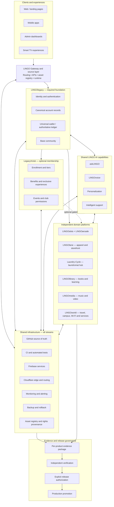

# LINGO Complete System Architecture

**Status:** Architecture baseline / proposed implementation contract  
**Source of truth:** `thelingolegacy-blip/TheLingoLegacy`  
**Release posture:** Production protected; no promotion authority is implied by this document.

## 1. Architecture principles

1. **LINGOlegacy is the mandatory foundation.** It owns canonical identity, authentication, account records, base community identity, and the authoritative wallet/ledger contract.
2. **LegacyXclub is optional.** It owns club enrollment, tiers, benefits, events, and club-specific permissions. It depends on LINGOlegacy identity; ordinary LINGOlegacy access must not require club membership.
3. **AI is a shared capability, not an authority bypass.** Domains call approved AI/voice/personalization services through authenticated, rate-limited server interfaces. AI cannot grant identity, wallet, membership, publishing, or administrative permissions.
4. **Domains are independently buildable.** Each product owns its domain data and business rules and consumes shared contracts rather than duplicating identity or wallet truth.
5. **Infrastructure is cross-cutting.** GitHub, CI, Firebase, Cloudflare, monitoring, backups, asset provenance, and evidence services support every domain.
6. **Parallel development does not imply parallel production release.** Each product must independently satisfy its evidence and authorization gates.

## 2. System diagram

## 3. Ownership and trust boundaries

| Capability | Authoritative owner | Consumers / constraints |
|---|---|---|
| Identity, credentials, sessions | LINGOlegacy identity service | All products; no domain-local competing identity |
| Account profile | LINGOlegacy account service | Domain-specific profile extensions remain domain-owned |
| Wallet and ledger | LINGOlegacy wallet service | Server-authoritative, auditable, idempotent writes; no client balance authority |
| Club enrollment and benefits | LegacyXclub | Optional overlay; requires valid LINGOlegacy identity |
| Game state and progression | Each game domain | May reference canonical identity; cannot mint redeemable value |
| Apparel catalog and orders | LINGOlane commerce domain | Inventory/order ownership stays in commerce; payments require separate approval |
| Laundromat operations | Laundry-Cycle domain | Machine, booking, and service records remain domain-owned |
| Books and learning content | LINGOlibrary | Rights/provenance required before publication |
| Music and video releases | LINGOmedia | Rights, consent, distribution, and release approval required |
| AI requests and model policy | Shared LINGO AI service | Server-side provider secrets, authenticated callers, rate/cost/safety controls |
| Edge routing and delivery | Cloudflare | No production route or Worker changes without change control |
| Source and review history | GitHub | Protected branches and retrievable checks required |
| Evidence and release decisions | Evidence/release governance | Independent verification; no self-approval |

## 4. Shared data-flow contract

1. A client request enters through an approved gateway route.
2. The gateway validates route, origin, request method, and session context.
3. LINGOlegacy authenticates the principal and resolves canonical account identity.
4. The target domain authorizes the requested action using its own business rules and the shared identity contract.
5. Optional LegacyXclub entitlements are checked only for club-gated features.
6. AI calls, when used, receive scoped context and cannot elevate the caller's permissions.
7. Authoritative writes occur server-side in the owning domain service; wallet changes use the wallet ledger contract.
8. Audit events, monitoring signals, and evidence metadata are emitted without exposing secrets or sensitive payloads.
9. Retries are idempotent; cross-domain events carry stable IDs and trace/correlation IDs.

## 5. Parallel workstream boundaries

- **Gateway/source recovery:** reproduce route and asset failures; reconcile source commit, build output, hostname, and deployed version.
- **Identity and wallet:** settle Firebase project/environment ownership, replace placeholders only from owner-controlled configuration, and verify Auth/session/rules/ledger behavior in non-production.
- **LegacyXclub:** implement membership as an optional entitlement layer with server-side authorization.
- **AI:** build authenticated provider-backed requests, rate limits, safety controls, observability, and cost ceilings; no client-side provider secrets.
- **Games:** verify game sessions, progression, virtual-credit boundaries, and cross-device state.
- **LINGOlane:** verify catalog, inventory, cart, orders, and payment-provider test mode before any live commerce activation.
- **Laundry-Cycle:** verify machine/service inventory, reservations, operational permissions, and any payment boundary separately.
- **LINGOlibrary and LINGOmedia:** verify content workflow, rights, consent, review, publication, and distribution.
- **LINGOworld:** verify each service independently; a shared navigation card is not proof that the destination is operational.
- **Infrastructure/release:** verify branch protection, CI execution, Cloudflare ownership/routing, monitoring, backup, rollback, and commit-to-deployment provenance.
- **Evidence/release:** maintain a separate evidence package and verdict for every product.

## 6. Agent and automation safety model

Agents may work in parallel on isolated, non-production branches for read-only analysis, documentation, test generation, and reversible scaffolding. Each role must have least privilege and a named work package. No agent may:
- access or print live secrets;
- grant itself permissions or approve its own work;
- change production DNS, routes, Workers, billing, payments, or identity configuration;
- register or replace a persistent runner;
- merge or promote a release;
- publish assets without verified rights and owner approval.

The orchestrator tracks dependencies and evidence; it does not bypass product owners or independent reviewers.

## 7. Product-specific evidence and release gate

Every product must provide all of the following:

1. Exact source repository, branch, commit SHA, and environment.
2. Reproducible dependency installation and build commands.
3. Executed unit, integration, security, and applicable accessibility tests.
4. Retrievable logs and artifacts with SHA-256 digests.
5. Build artifact to deployed version/commit correlation.
6. Browser/API/device journey tests for the product's critical user flows.
7. Authorization, data-isolation, privacy, and asset-rights review.
8. Monitoring/alerting and rollback procedure with verified recovery point.
9. Independent reviewer verdict and owner acceptance.
10. Separate explicit authorization for production promotion.

Acceptance sequence:

`SOURCE → ACTUAL EXECUTION → RETRIEVABLE EVIDENCE → INDEPENDENT VERIFICATION → ACCEPTANCE → AUTHORIZATION → PROMOTION`

A preview marked ready, HTTP 200, screenshot, static check, queued workflow, or provider status is not sufficient evidence of operational acceptance.

## 8. Current known blockers to preserve

- GitHub main-branch protection and required release checks require owner/admin remediation and read-back verification.
- G02 remains FAIL / UNVERIFIED; do not attach a privileged persistent runner to the public application repository.
- Firebase Hosting on current `main` still points to repository root; the separate `build/web` proposal is not yet merged.
- Firebase project/environment identity is unresolved and Flutter Firebase configuration contains placeholders.
- Gateway staging static-asset success and previously recorded runtime failures must be reconciled by host, snapshot, timestamp, and exact URL.
- askLINGO model-provider/authenticated execution is not yet proven.
- Studio and Enterprise previews do not yet prove complete authenticated workflows or live telemetry.
- Mobile release configuration, store submissions, and device acceptance remain incomplete.
- Commerce, publishing, media, rights, and cross-domain integrations require product-level end-to-end evidence.
- AppDeploy credit exhaustion is a provider constraint; do not spend, top up, retry deployments, or use alternate accounts as a workaround.
- Production and last-known-good remain protected.

## 9. Current release disposition

**Architecture baseline:** documented proposal  
**Parallel non-production work:** permitted within existing access and budget  
**Product acceptance:** pending evidence per product  
**G02:** NO-GO / UNVERIFIED  
**Production promotion:** HOLD

This document defines boundaries and acceptance criteria. It does not claim that any unverified integration is connected or authorize a production change.
