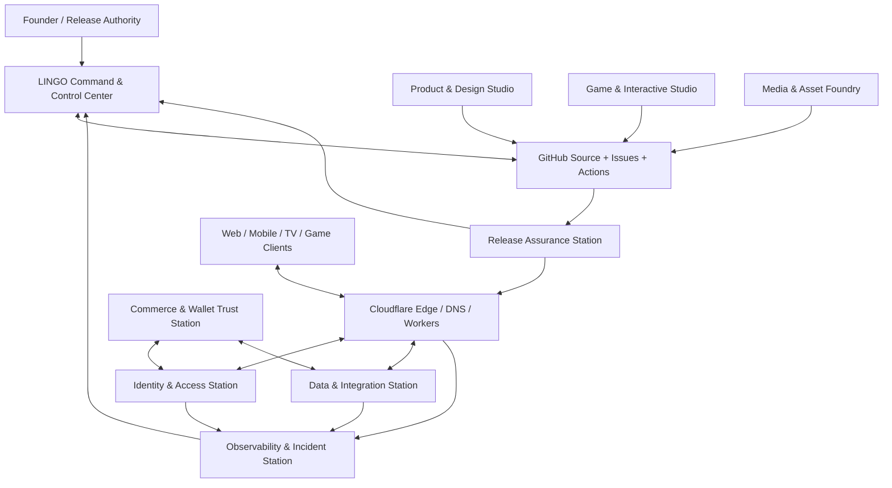

# LINGO Legacy Command & Control Architecture v1

**Status:** Proposed architecture baseline — review required  
**Repository:** `thelingolegacy-blip/TheLingoLegacy`  
**Branch:** `architecture/lingo-command-control-centers-v1`  
**Authority:** GitHub `main` remains the source of truth. This document does not authorize production mutation, service activation, payment activation, runner registration, DNS changes, or release promotion.

## 1. Design objective

Create one coordinated operating architecture for the LINGO Legacy ecosystem. Logical centers and stations are ownership boundaries, not claims that separate physical servers, paid services, or already-running services exist. Prefer the existing approved stack and free-tier resources; add infrastructure only when a measured requirement and cost/security review justify it.

## 2. System topology

## 3. Centers and stations

| ID | Center / station | Primary ownership | Initial implementation boundary |
|---|---|---|---|
| C2 | **LINGO Command & Control Center** | Portfolio state, priorities, dependencies, decisions, workstream coordination, incident command | GitHub issue #517 as current Control Tower; canonical decision and status documents in this repo |
| ENG | **Engineering & Automation Station** | Repository structure, code review, CI workflows, tests, build provenance, artifact lineage | GitHub repositories, Actions workflows, protected branches and review gates |
| EDGE | **Network & Edge Operations Center** | DNS inventory, Worker routing, edge APIs, caching, static assets, runtime config | Cloudflare zone, Worker `thelingolegacyv-5`, route inventory; read-only until release authorization |
| IAM | **Identity, Access & Trust Station** | Account identity, session lifecycle, authorization, roles, consent, audit trails | Firebase Auth as intended identity provider; server-verified authorization, least privilege |
| DATA | **Data & Integration Station** | Canonical data contracts, persistence, migrations, event schemas, service adapters | Firebase as intended primary application backend; avoid parallel competing sources of truth |
| UX | **Product & Experience Design Studio** | Design system, journeys, accessibility, responsive behavior, design QA | Repository-owned tokens/components and approved design artifacts |
| GAME | **Game & Interactive Systems Studio** | Unity/browser game architecture, simulation, economy rules, progression, QA | Per-game modules and deterministic domain logic; no coupling to account/payment internals |
| MEDIA | **Media & Asset Foundry** | Brand assets, audio/video, book/media catalog, licensing, metadata, optimization | Versioned asset manifest and rights metadata in GitHub; large binaries in approved asset storage |
| COM | **Commerce, Wallet & Trust Station** | Product catalog, checkout orchestration, ledger, rewards, fraud controls, reconciliation | Separate commerce adapters and append-only ledger design; no cash-out or real-money game wagering |
| OBS | **Observability & Incident Response Center** | Logs, metrics, traces, uptime, alerts, incident response, SLOs | Structured telemetry and dashboards; never log secrets, tokens, payment credentials or sensitive personal data |
| REL | **Release Assurance & Recovery Station** | Gate evaluation, test evidence, rollback, LKG protection, release certification | GitHub release evidence and immutable deployment/version references |

## 4. Shared platform layers

1. **Experience layer:** flagship web, mobile, smart-TV, and game clients. Clients call versioned APIs; they never hold privileged provider credentials.
2. **Edge/API layer:** Cloudflare Worker validates request shape, applies security headers/rate limits, routes only explicit API paths, and serves only an explicit public asset surface.
3. **Identity layer:** Firebase Auth (intended) establishes identity. Backend services verify signed tokens and independently authorize every operation. Authentication is not authorization.
4. **Domain services:** account/profile, catalog, community, library/media, game session/progression, commerce, wallet/ledger, notifications, support and AI gateway. Each domain owns its schema and API contract.
5. **Persistence layer:** Firebase/Firestore is the intended primary app data platform. Use transactions and server-side rules for sensitive writes. Do not introduce a second primary database without an architecture decision.
6. **Integration layer:** provider adapters isolate Cloudflare, Firebase, Stripe, AI providers, analytics and content tools. Each adapter has explicit scopes, timeouts, retries, idempotency and failure behavior.
7. **Control/evidence layer:** GitHub tracks source, change approvals, workflow evidence, artifacts, deployment references and release decisions.

## 5. Core contracts and connection rules

- **One source of truth per concern:** GitHub for source/governance; Firebase for intended application identity/data; Cloudflare for authoritative edge/routing; a ledger service for monetary/reward accounting.
- **API versioning:** use `/api/v1/<domain>/<resource>`; publish request/response schemas and compatibility policy.
- **No direct client-to-provider secrets:** privileged operations run server-side.
- **Service-to-service identity:** short-lived scoped credentials, least privilege, rotation procedure, and audit events.
- **Events:** use a versioned envelope with `event_id`, `event_type`, `schema_version`, `occurred_at`, `producer`, `correlation_id`, and a minimal payload. Consumers must be idempotent.
- **Failure isolation:** timeouts, bounded retries with jitter, circuit breakers where justified, dead-letter handling for durable asynchronous work, and explicit degraded states.
- **Data classification:** public, internal, confidential, restricted. Secrets and payment credentials are never committed to GitHub or emitted in logs.
- **Asset boundary:** never serve repository root as a public asset directory without a proven allowlist/denylist and negative tests. Public assets must be allowlisted and internal paths denied before asset fetch.
- **AI gateway:** model providers are independent adapters; user data and tool permissions are scoped per request. Model output is untrusted input and cannot bypass authorization.
- **Game economy:** play currency and rewards are isolated from payment credentials and cannot be redeemed or cashed out unless a separately reviewed lawful product specification authorizes it.

## 6. Suggested domain connection map

| Client / world | Domain services | Shared platform dependencies |
|---|---|---|
| LINGOlegacy flagship | profile, community, catalog, notifications | IAM, DATA, EDGE, OBS |
| LINGOlane | apparel catalog, orders, fulfillment, promotions | IAM, COM, DATA, OBS |
| LINGOslots | game sessions, progression, virtual play balance | IAM, GAME, DATA, OBS |
| LINGOarcade | game sessions, achievements, catalog | IAM, GAME, DATA, OBS |
| LINGOlibrary | books, reading progress, media metadata | IAM, MEDIA, DATA, OBS |
| LINGOmedia | media catalog, playback metadata, rights | MEDIA, DATA, EDGE, OBS |
| LINGOworld | AI gateway, travel/campus/support/community modules | IAM, DATA, integration adapters, OBS |
| LegacyXclub | membership, community, events | IAM, DATA, notifications, OBS |

These are target ownership relationships. Existing route, API, schema and deployment evidence must be reconciled before treating any row as implemented.

## 7. Security and release boundaries

- Maintain protected hold until the actual required CI jobs run and complete with correlated run, job, commit, logs and artifacts.
- G02 self-hosted runner registration is a separate infrastructure dependency; never fabricate runner identity or evidence.
- A workflow with zero jobs is a startup failure, not a successful test.
- Do not merge or deploy based only on a design document or source-level checks.
- Keep production Worker routes, DNS, Firebase production configuration, payment activation, secrets and LKG unchanged until explicit release gates and authorized approval.
- Do not expose internal control-plane or operations routes without authenticated Cloudflare Access and application-level authorization.
- Test public asset paths for traversal, encoded separators, case variants, dot segments and sensitive file extensions before any asset-scope change.

## 8. Delivery sequence

### Wave A — Inventory and contracts
- Inventory all repos, domains, Workers, routes, workflows, Firebase projects, API paths, data stores and deployed versions.
- Mark each component: verified live, source-only, preview-only, blocked, retired or unknown.
- Assign one accountable owner and acceptance test per station.

### Wave B — Safe foundations
- Close public asset exposure; establish API route allowlist, IAM boundaries, environment separation, secret handling and schema ownership.
- Define service registry and API/event contracts.
- Keep all production resources read-only until release approval.

### Wave C — Integration
- Connect clients through versioned edge APIs.
- Connect domains through explicit service adapters and idempotent event contracts.
- Add telemetry correlation across client, Worker, backend and workflow.

### Wave D — Verification and activation
- Unit/contract/integration tests; security and accessibility tests; browser/device QA; backup/restore and rollback rehearsal.
- Validate every live dependency and release artifact.
- Promote only after the release authority accepts the evidence.

## 9. Acceptance checklist

- [ ] Every center has a documented owner, scope, inputs, outputs and escalation path.
- [ ] Every production API has an owner, schema, authz policy, rate limit and test.
- [ ] Every data domain has one authoritative store and migration owner.
- [ ] All external integrations use scoped adapters; secrets remain out of source.
- [ ] Public asset surface is allowlisted and negative-tested.
- [ ] Observability correlates client request, Worker invocation, backend operation and release.
- [ ] CI evidence is real, complete and commit-correlated.
- [ ] LKG and rollback procedure are documented and rehearsed.
- [ ] Production activation has a separate explicit release approval.

## 10. Open decisions

1. Confirm the final Firebase project/environment split and exact Auth/Firestore ownership.
2. Confirm which domains need durable asynchronous queues versus synchronous APIs.
3. Select the ledger implementation and accounting/reconciliation owner before any wallet activation.
4. Confirm the canonical design-token source and asset storage policy.
5. Confirm smart-TV and mobile release targets and their QA device matrix.
6. Confirm the Cloudflare Access policy for internal control-plane surfaces.

**Decision rule:** build the smallest secure shared platform that supports all worlds; do not create a separate server or database for every station. Logical stations can share infrastructure while retaining clear ownership, contracts and isolation.
