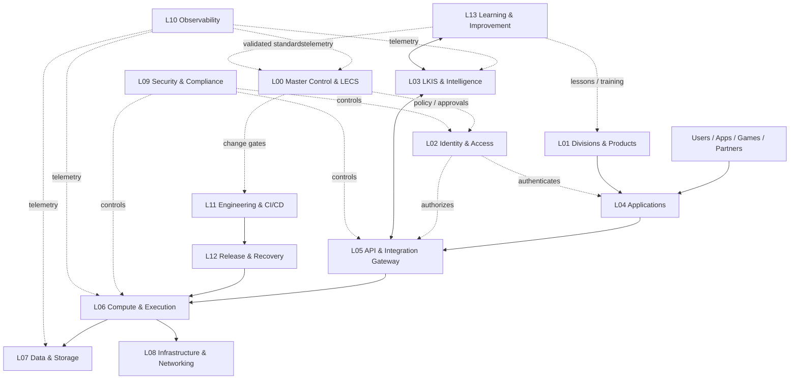

# LINGO Enterprise 14-Layer Reference Architecture

**Status:** Proposed logical architecture; source-controlled editable specification; not a live topology claim.

## Layer catalog

| Layer | Name | Primary responsibilities | Trust boundary / controls |
|---|---|---|---|
| L00 | Governance & Enterprise Command | Master Control, LECS, portfolio priorities, policy, approvals | Human identity, role separation, immutable audit, action-specific approval |
| L01 | Divisions & Product Portfolio | LINGOlegacy, LINGOlane, LINGOslots, LINGOarcade, LINGOlibrary, LINGOmedia, LINGOworld, LegacyXclub | Product ownership, tenant/world isolation, product lifecycle |
| L02 | Identity & Access | User identity, service identity, sessions, roles, entitlements | Least privilege, MFA where supported, token rotation, tenant isolation |
| L03 | Intelligence & Knowledge | LKIS, AI gateway, retrieval, research, knowledge validation | Source provenance, classification, model/provider boundaries, prompt-injection defenses |
| L04 | Application & Presentation | Web, mobile, smart-TV, admin, customer and creator interfaces | Client is untrusted; server-authoritative decisions; accessibility |
| L05 | API & Integration Gateway | Versioned APIs, webhooks, partner connectors, event contracts | Authentication, schema validation, rate limits, idempotency, audit |
| L06 | Compute & Execution | Cloudflare Workers, functions, containers, CI runners, scheduled jobs | Workload identity, sandboxing, scoped network and secrets, isolation |
| L07 | Data & Storage | Firebase/Firestore targets, databases, object storage, files, backups, archives | Data classification, encryption, retention, restore, integrity, access logs |
| L08 | Infrastructure & Networking | DNS, edge, CDN, hosting, network, compute capacity | Network segmentation, configuration control, change review |
| L09 | Security & Compliance | Threat modeling, vulnerability management, privacy, policy, key management | Non-overridable security/privacy invariants, incident escalation |
| L10 | Monitoring & Observability | Metrics, logs, traces, alerts, SLOs, audit streams | Time sync, source identity, retention, sensitive-field redaction |
| L11 | Engineering, Testing & CI/CD | GitHub source, reviews, builds, tests, artifact provenance, dependency scanning | Protected branches, trusted workflows, reproducible builds, independent checks |
| L12 | Release, Backup & Disaster Recovery | Release gates, staging, rollback, restore, continuity, archive lifecycle | Exact-SHA authorization, tested restore, last-known-good protection |
| L13 | Learning, Education & Improvement | LINGO Academy, technical library, training, lessons, continuous improvement | Approved sources, versioned curriculum, freshness, evaluation and feedback |

## Logical flow

Dashed arrows are logical governance/telemetry relationships, not proof of deployed connectors. Actual connectors must be recorded in the machine-readable registry with source and target IDs.

## Required connection record

Every edge in the architecture must define:
- stable connection ID;
- source and target component IDs;
- direction and data-flow purpose;
- protocol/interface and contract version;
- authentication and authorization mechanism (never secret values);
- data classification and tenant scope;
- owner on both ends;
- dependency and criticality;
- health/readiness probe and expected result;
- retry, timeout, idempotency, circuit-breaker and failure behavior;
- audit/telemetry references;
- backup, rollback, and recovery procedure;
- implementation state and evidence references;
- last verified timestamp and next review.

## Standard failure paths

1. **Identity failure:** deny access, preserve audit, alert owner; no anonymous fallback for protected operations.
2. **API/schema failure:** reject invalid payload, return safe error, retain correlation ID, do not partially commit.
3. **Worker/function failure:** bounded retries only for idempotent work; route to dead-letter/quarantine where supported; alert.
4. **Database failure:** stop dependent writes, preserve transaction integrity, invoke approved restore/failover procedure.
5. **Storage failure:** preserve source, verify checksums, retry safely, never treat a storage sink as deletion.
6. **AI/provider failure:** degrade to explicit unavailable state or approved fallback; preserve citations; never fabricate completion.
7. **CI/runner failure:** mark BLOCKED/FAIL according to observed evidence; do not convert zero-job startup failure into a code pass.
8. **Release failure:** halt promotion, preserve last-known-good, execute tested rollback only under approved procedure.
9. **Monitoring failure:** mark observability degraded; do not infer service health from missing telemetry.
10. **Knowledge conflict/staleness:** surface conflict, retain source versions, require owner review before updating authoritative guidance.

## Rendering and editing

This Markdown file is the editable source for the layer catalog and Mermaid diagram. A later diagram export may be generated from the service and connection registry. Generated diagrams must retain stable IDs and must not become a competing source of truth.
