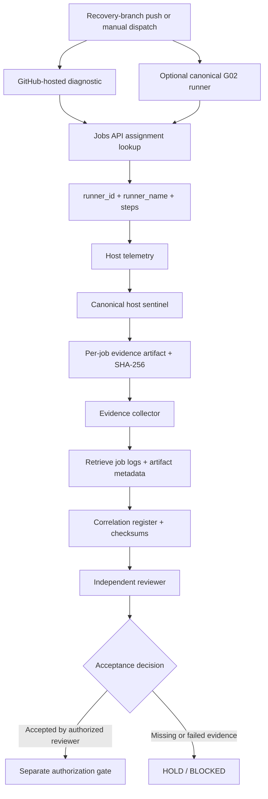

# G02 Evidence and Acceptance Design

**Status:** Proposed implementation on PR #425; not yet executed or accepted.  
**Security posture:** Read-only GitHub API access, host-local read-only telemetry, no production mutations.

## Objective

Turn G02 runner qualification into a traceable evidence chain. The workflow supports a scoped push diagnostic on the dedicated recovery branch and a manual dispatch; the canonical self-hosted lane remains explicitly opt-in. Every assertion must point to an independently retrievable GitHub job, runner identity, executed sentinel, log archive, artifact, and checksum.

## Evidence flow

## Correlation model

- Run key: `g02:<repository>:<run_id>:<run_attempt>`
- Job key: `g02:<repository>:<run_id>:<run_attempt>:<job_id>`
- Runner identity is sourced from the GitHub Actions Jobs API response, not inferred from environment variables.
- `runner_id` must be a positive integer; `runner_name` must exactly equal `lingo-legacy-g02` for canonical qualification.
- The job's returned `steps` array is preserved as execution evidence.
- Host telemetry includes OS/kernel, architecture, CPU/memory/disk/uptime, a one-way host fingerprint, runner root and registration-file presence, diagnostic directory presence, service state, and runner process counts. No secrets, environment dumps, IP addresses, or raw machine identifiers are collected.

## Canonical G02 sentinel

The optional self-hosted lane requires:
- Positive API-derived runner ID.
- Exact runner name `lingo-legacy-g02`.
- Labels `self-hosted, linux, x64, lingo-g02`.
- Linux x64 runtime and required tools.
- `/opt/actions-runner`, `.runner`, and `_diag` presence.
- `actions.runner.lingo-legacy-g02.service` active.
- A live `Runner.Listener` process.

A failed or missing check is a failed sentinel. Hosted-runner evidence is diagnostic only and cannot qualify G02.

## Logs, artifacts, and integrity

The final collector queries the run's Jobs and Artifacts APIs after dependent jobs complete. It downloads job log archives and G02 evidence artifacts, records HTTP retrieval status, and computes SHA-256 for every retrieved file. The correlation register records job IDs, runner identity, step summaries, artifact IDs, log availability, checksums, and a conservative eligibility flag.

## Acceptance boundary

`eligible_for_independent_review` means the evidence bundle is sufficiently complete to be reviewed. It is not an acceptance verdict. The register always records `PENDING_INDEPENDENT_REVIEW` and `promotion_authorized: false`. An independent reviewer must retrieve the GitHub run, inspect logs and artifacts, recompute checksums, verify the runner host against the approved inventory, and record a separate signed acceptance decision.

## Known external dependency

A workflow with zero instantiated jobs cannot collect its own evidence. The observed G02 Control Watch run #44 ended in `startup_failure` with zero jobs and zero artifacts. This repository change cannot repair GitHub's hosted-runner allocation service or provision the missing persistent G02 host. Those are separate infrastructure/provider actions.
