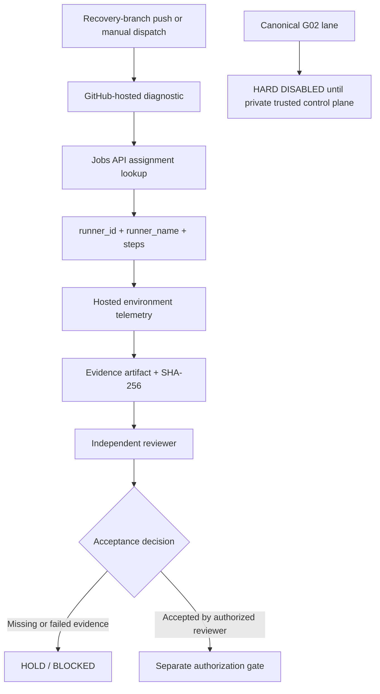

# G02 Evidence and Acceptance Design

**Status:** Proposed implementation; not yet executed or accepted.  
**Security posture:** Read-only GitHub API access, host-local read-only telemetry, no production mutations.  
**Canonical runner posture:** HARD DISABLED in the public repository pending a trusted private control plane and verified host isolation.

## Objective

Turn G02 runner qualification into a traceable evidence chain. The hosted diagnostic lane may test GitHub-hosted runner allocation. It cannot qualify G02. Canonical self-hosted execution is intentionally disabled in this public repository: the workflow must not execute code from a user-selectable dispatch ref on a persistent privileged runner.

## Security boundary

- The canonical self-hosted job has a literal false job condition and cannot be enabled by the workflow-dispatch boolean input.
- Its body contains no checkout, script execution, token use, or host inspection.
- Do not remove this hard disable merely because a Linux host becomes available.
- Before designing a replacement, establish a private runner-control repository or equivalent private control plane with independently enforced protected refs and immutable trusted revisions.
- The runner must be isolated from host credentials, the Docker socket/host, unrelated workloads, and untrusted pull-request code. A persistent privileged host running code checked out from a public repository is not an acceptable boundary.
- The trust policy and isolation must be independently reviewed and tested before any canonical runner registration or dispatch.

## Evidence flow

## Correlation model

- Run key: `g02:<repository>:<run_id>:<run_attempt>`
- Job key: `g02:<repository>:<run_id>:<run_attempt>:<job_id>`
- Runner identity is sourced from the GitHub Actions Jobs API response, not inferred from environment variables.
- `runner_id` must be a positive integer; `runner_name` must exactly equal `lingo-legacy-g02` for canonical qualification.
- The job's returned `steps` array is preserved as execution evidence.
- Host telemetry includes OS/kernel, architecture, CPU/memory/disk/uptime, a one-way host fingerprint, runner root and registration-file presence, diagnostic directory presence, service state, and runner process counts. No secrets, environment dumps, IP addresses, or raw machine identifiers are collected.

## Canonical G02 acceptance requirements

After the private trusted control plane and host isolation are independently approved, a future canonical lane must require:
- Positive API-derived runner ID.
- Exact runner name `lingo-legacy-g02`.
- Labels `self-hosted, linux, x64, lingo-g02`.
- Linux x64 runtime and required tools.
- `/opt/actions-runner`, `.runner`, and `_diag` presence.
- `actions.runner.lingo-legacy-g02.service` active.
- A live `Runner.Listener` process.
- Executed steps, retrievable logs and artifacts, and recomputed SHA-256 hashes.

A failed or missing check is a failed sentinel. Hosted-runner evidence is diagnostic only and cannot qualify G02.

## Logs, artifacts, and integrity

A future final collector may query the run's Jobs and Artifacts APIs after dependent jobs complete. It must download job log archives and G02 evidence artifacts, record HTTP retrieval status, and compute SHA-256 for every retrieved file. The correlation register records job IDs, runner identity, step summaries, artifact IDs, log availability, checksums, and a conservative eligibility flag.

## Acceptance boundary

`eligible_for_independent_review` means the evidence bundle is sufficiently complete to be reviewed. It is not an acceptance verdict. The register always records `PENDING_INDEPENDENT_REVIEW` and `promotion_authorized: false`. An independent reviewer must retrieve the GitHub run, inspect logs and artifacts, recompute checksums, verify the runner host against the approved inventory, and record a separate signed acceptance decision.

## Known external dependency

Recent GitHub Actions runs have ended in `startup_failure` with zero jobs and zero artifacts. A workflow with zero instantiated jobs cannot collect its own evidence. Repository changes cannot repair GitHub's hosted-runner allocation service or provision the missing persistent G02 host. Those are separate provider and infrastructure actions.
