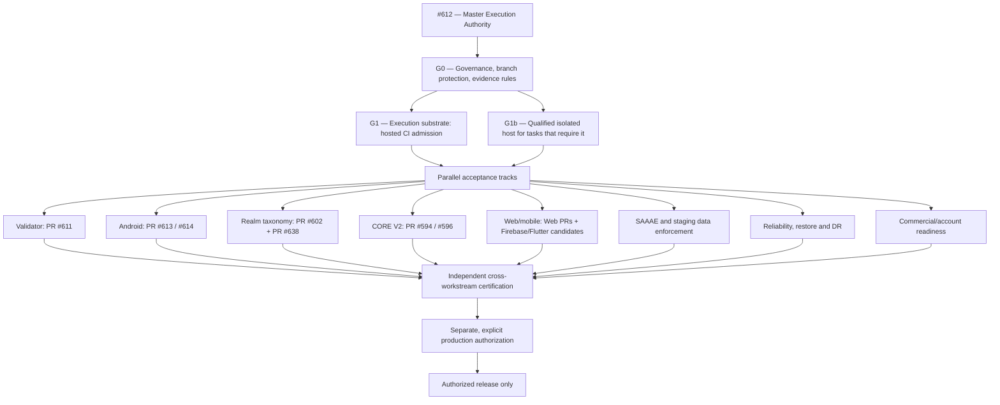

# THE LINGO LEGACY — Master Dependency, RACI, RAPID & Acceptance Register

**Document class:** Controlled master governance artifact  
**Controlling work order:** GitHub issue [#612 — MASTER EXECUTION WORK ORDER](https://github.com/thelingolegacy-blip/TheLingoLegacy/issues/612)  
**Related authorities:** [#575 cross-stack blocker register](https://github.com/thelingolegacy-blip/TheLingoLegacy/issues/575) · [#597 master program](https://github.com/thelingolegacy-blip/TheLingoLegacy/issues/597) · [#480 acceptance baseline](https://github.com/thelingolegacy-blip/TheLingoLegacy/issues/480) · [#601 release readiness](https://github.com/thelingolegacy-blip/TheLingoLegacy/issues/601)  
**Repository:** `thelingolegacy-blip/TheLingoLegacy`  
**Core baseline recorded:** `b047ffce8fb18c0ba702605667dff8291d60caa9`  
**Web baseline recorded:** `thelingolegacy-blip/TheLingoLegacy-Web` @ `087332a2bd1b2697ceb1bfea96720748b9a79ebb`  
**Checkpoint:** 2026-11-28 (point-in-time; refresh before any execution or acceptance decision)  
**Document status:** DRAFT — review and reconciliation required  
**Release posture:** PROTECTED HOLD; production release NOT AUTHORIZED

> This register extends the existing master operating-system and registry-template proposals. It does not replace #612, #575, #597, #480 or #601; it does not create a second master program; and it does not assert that proposed roles, dependencies, candidate realms, or controls have been accepted. Link existing work rather than duplicate it.

## 1. Purpose and control hierarchy

Provide one traceable control surface for dependency sequencing, delivery accountability, decision rights, evidence requirements and acceptance across THE LINGO LEGACY.

| Control level | Canonical reference | Role |
|---|---|---|
| Master execution | #612 | Authoritative work order and execution checklist |
| Blocker register | #575 | Cross-stack blocker tracking |
| Master program | #597 | Portfolio program coordination |
| Acceptance baseline | #480 | Consolidated ecosystem gaps and product acceptance |
| Release readiness | #601 | Independent certification and release-readiness scope |
| Core source | TheLingoLegacy / `main` | Canonical Core source history |
| Web source | TheLingoLegacy-Web / `main` | Separate canonical Web source history |
| Master operating blueprint | PR #674 | Draft AI installation and contributor operating system |
| Enterprise architecture / taxonomy proposal | PR #638 | Draft architecture and portfolio taxonomy; branch is divergent from current Core main |
| 14-node realm proposal | PR #602 | Draft candidate realm registry; not accepted or deployed |

**Authority rule:** If this register conflicts with an existing controlling issue, accepted ADR, product-specific contract, or separately approved release decision, the controlling source takes precedence. Record the conflict and reconcile it; do not silently overwrite it.

## 2. Status vocabulary and evidence discipline

Use the status vocabulary already present in the enterprise architecture proposal:

- `NOT STARTED`
- `IN PROGRESS`
- `BLOCKED`
- `PASS — EVIDENCE LINKED`
- `ACCEPTED`

A source edit, draft PR, static inspection, preview URL, HTTP 200, provider-ready label, screenshot, issue closure, or workflow run with zero jobs is not operational acceptance.

### Evidence record minimum

Every acceptance record must identify:

1. Requirement ID and acceptance criterion.
2. Exact repository, branch, immutable commit SHA and changed artifact/blob SHA where applicable.
3. Target environment and resource identity; distinguish local, preview, staging and production.
4. Exact command/procedure, toolchain and dependency-lock state.
5. Workflow/run ID, job ID, runner identity, executed step results, retrievable logs and artifact identifiers where CI is involved.
6. Artifact checksum and independent integrity/read-back result.
7. Test result, including explicit NOT RUN / BLOCKED / FAILED where applicable.
8. Executor identity, independent reviewer identity, timestamps and approval record.
9. Exceptions, residual risks, remediation owner and rollback/recovery reference.
10. Separate release authorization where a production change is proposed.

**Independence rule:** The executor cannot self-certify a complex or security-sensitive deliverable. Reviewer identity and authority must be independently established; two different text labels or account names do not prove two different human identities.

**CI rule:** A startup failure, zero-job run, zero executed steps, missing logs or missing required artifact is an execution-infrastructure failure, not an application test failure and not a pass. Local execution does not prove hosted CI acceptance. A successful preview does not prove production acceptance.

## 3. Dependency and execution map

The sequence below is a **control-gate order**, not a claim that every engineering task is a hard technical prerequisite of every other task. Safe, isolated work may proceed in parallel when it does not bypass a shared gate, alter shared files without coordination, expose production, or create competing sources of truth.

### Gate definitions

| Gate | Required outcome | Entry / dependency | Exit evidence |
|---|---|---|---|
| G0 — Governance | Effective Core and Web branch protection, required checks/reviews, least-privilege settings and named authority | Owner/admin access; current policy inventory | Read-back of effective settings, rulesets, bypass actors, required checks and audit evidence for both repositories |
| G1 — Hosted CI | GitHub-hosted execution is admitted and stable | G0 policy reviewed; no production secrets in diagnostic jobs | Repeated real jobs, runner identity, completed named steps, retrievable logs, commit-correlated checksummed artifacts |
| G1b — Isolated execution | A qualified disposable/unprivileged environment exists for work that requires it | Explicit host qualification and operator authorization | Host identity/configuration, isolation evidence, exact candidate SHA, command, output, tests, logs and checksums |
| G2 — Engineering acceptance | Product/validator/mobile/core candidates execute and pass their own tests | Suitable hosted or approved isolated execution path | Exact-SHA build/test results and independent review; failures remain visible |
| G3 — Portfolio reconciliation | Candidate realm nodes, public portfolios, subproducts and shared platform services are classified consistently | Current-main ancestry and existing PR overlap review | Reviewed registry/taxonomy, ownership decisions, link/route checks and no duplicate records |
| G4 — Product/security acceptance | Web/mobile, identity, SAAAE, data and product-specific controls are independently verified | Relevant product-specific prerequisites; staging identities/resources | Negative/positive authorization tests, current-head QA, data boundary tests and owner/reviewer evidence |
| G5 — Operational resilience | Backup/restore, rollback, RTO/RPO, monitoring and incident paths are demonstrated | Qualified non-production test environment and approved recovery plan | Restore logs, checksums, measured recovery results, rollback drill and independent sign-off |
| G6 — Commercial readiness | Provider access, account status, legal/finance requirements and operating readiness are verified | Account-owner access and current provider records | Dated account evidence, reconciled fee/eligibility terms, ownership/KYC/tax/payout status where applicable; no assumed activation |
| G7 — Certification | All in-scope deliverables meet acceptance criteria and residual risks are recorded | G0–G6 applicable gates complete | Independent certification package correlated to exact artifacts and evidence |
| G8 — Release authority | A separate authorized decision is recorded for a specific release candidate and target | G7 accepted; exact release candidate and rollback path | Explicit approval record naming SHA/artifact, environment, scope, approver and time |

### Dependency notes

- G0 is a governance prerequisite for accepting protected-source and release-control work. The account owner/admin must restore and verify effective protection; a policy statement alone is not enforcement.
- G1 and G1b are distinct. Hosted Actions recovery does not prove G02 self-hosted runner acceptance, and a qualified isolated host does not repair GitHub-hosted Actions admission.
- PR #611, Android reconciliation, realm taxonomy, CORE V2 source review, Web/mobile QA planning, SAAAE policy design, reliability planning and commercial account review may progress in isolated parallel tracks. Their *acceptance* remains subject to the relevant execution and security gates.
- PR #613/#614 must be reconciled file-by-file on a current-main basis. Neither branch is authorized for wholesale merge. The reported Gradle wrapper JAR checksum mismatch is a hard stop for executing that wrapper until trusted provenance and checksum are established.
- PR #615 requires its own qualified host. An acknowledgement flag or network-enabled mode is not proof of process isolation.
- PR #602 must be reconciled with the current portfolio canon and PR #638's taxonomy proposal. Do not create a second realm registry.
- CORE V2, SAAAE and data integration share identity and authorization contracts; resolve issuer/subject, role separation, policy enforcement and audit ownership before treating them as independent production-capable systems.
- Product acceptance is per product and per target platform. Web preview success, mobile source compilation, a static page, or one game's acceptance does not certify another product.
- Commercial account research and read-only account verification may proceed separately from engineering, but payments, paid campaigns, subscriptions, account changes and financial commitments remain separately authorized.
- G8 is never implied by G7. Production remains PROTECTED HOLD until a separate explicit authorization is recorded.

## 4. Consolidated execution register

The following 12 work packages carry forward the November 28 checkpoint. Statuses are the reported point-in-time state, not live claims.

| Priority | Work package / existing source | Reported state | Next acceptance gate |
|---:|---|---|---|
| 1 | GitHub governance — Core and Web main; #612 / #470 | BLOCKED — branch API reported `protected=false` and required checks disabled | Owner/admin restores effective protection; independently re-read rules, required checks and bypass settings on both repos |
| 2 | Hosted CI and G02 — #575; runner preparation #665/#666 | BLOCKED — hosted runs have no usable execution evidence; G02 FAIL / UNVERIFIED | Real hosted runner identity, instantiated job, completed steps, logs and integrity-checked artifact; keep G02 separate |
| 3 | Validator — PR #611 | SOURCE REPAIRED — HOSTED TESTS PENDING | Execute all 34 authored test methods at exact head SHA; independently bind human identities and resolve evidence references |
| 4 | Android branch reconciliation — PR #613 / #614 | BLOCKED — divergent implementations; wrapper integrity mismatch | Reconcile shared files on current main; preserve useful probe; verify trusted official wrapper JAR provenance/checksum before execution |
| 5 | Isolated-host orchestrator — PR #615 | BLOCKED — no qualified host | Qualify disposable/unprivileged host; run exact candidate SHA; retain host identity, commands, output, tests and checksums |
| 6 | Realm and portfolio taxonomy — PR #602 / #638 / #548 | SOURCE CANDIDATE — NOT ACCEPTED | Reconcile ancestry and taxonomy; preserve 14 candidate nodes while distinguishing public portfolios, subproducts and shared platform capabilities |
| 7 | CORE V2 and API — PR #594 / #596 | IN PROGRESS — NON-PRODUCTION | Commit actual Go dependency lockfile; execute format, test, race, vet, build and PostgreSQL integration acceptance; finish outbox/replay/dead-letter controls |
| 8 | Web and mobile — Web PR #50, #49, #46; Core #654/#655 and Flutter candidates | PARTIAL SOURCE/PREVIEW EVIDENCE — CURRENT-HEAD QA PENDING | Verify current Web main head separately from earlier preview SHA; browser/device QA; resolve wrapper and Firebase staging identity/config before native acceptance |
| 9 | SAAAE, identity and data — #643, #658, #659; staging inventory | FOUNDATION MERGED — RUNTIME ENFORCEMENT UNVERIFIED | Prove server-side default deny, role/attribute decisions, distinct human approvers, MFA, Access policies, audit integrity and staging DB/Worker bindings |
| 10 | Reliability / DR — #615 and #601 | INCOMPLETE | Demonstrate backup restore, integrity, RTO/RPO, rollback, SLO/alert ownership and incident runbooks |
| 11 | Commercial and operational readiness | ACCOUNT COVERAGE / ACCESS PARTIAL; historical billing findings require refresh | Verify current account/provider state, legal/fee/eligibility terms, ownership, tax/KYC and payout status where relevant; do not pay or activate without separate approval |
| 12 | Independent certification and release readiness — #601 / #480 / #612 | NOT CERTIFIED; PROTECTED HOLD | Independent evidence review across applicable gates; record residual risks; obtain separate release authorization for a specific candidate |

### Required evidence by work package

**1 — GitHub governance**
- Record repository identity and main SHA for Core and Web.
- Capture effective branch protection, rulesets, required checks, required approvals, CODEOWNERS/review requirements, force-push/deletion restrictions and bypass actors.
- Confirm read-back after owner/admin changes. Connector visibility failures must be reported, not interpreted as secure defaults.
- No repository settings are changed by this register.

**2 — Hosted CI and G02**
- Hosted CI acceptance requires repeated successful job instantiation and actual step execution, with runner ID/name, run/job IDs, exact SHA, logs, artifacts and checksums.
- Diagnose account entitlement, organization Actions policy, quotas, concurrency and billing/usage restrictions with GitHub account owner/support.
- G02 requires separate runner provisioning/registration authorization, exact runner identity/labels, sentinel execution, logs and artifact integrity. Do not infer G02 from installer files or hosted runner success.

**3 — PR #611**
- The 34 authored test methods must execute in a real approved environment at the reviewed exact SHA.
- `identity_assignment: UNASSIGNED` remains an acceptance gap.
- Evidence references must be resolved and validated; nonempty strings are not proof.
- Owner/reviewer strings must map to independently authenticated human identities and distinct approval actors.

**4 — PR #613 / #614**
- Reconcile all shared paths against current main and preserve unique, independently reviewed changes.
- Do not execute the wrapper JAR with the reported checksum discrepancy.
- Record the official distribution/source, version, file digest and independent checksum match before use.
- Require a reproducible Android build and device evidence; preserve Android minSdk 21 where required by the approved product baseline.

**5 — PR #615**
- The candidate script must run only on a qualified disposable, unprivileged host with no provider credentials or host mounts.
- Network-enabled execution does not itself sandbox child-process egress.
- Record isolation configuration and actual execution; an acknowledgement flag is not isolation evidence.

**6 — PR #602 / #638**
- PR #602 remains draft and is stacked on older #548 ancestry; reconcile base/head before integration.
- PR #638 contains a detailed taxonomy proposal but its recorded branch is substantially behind/divergent from current main. Do not merge wholesale.
- Public portfolio manifest, candidate realm registry, internal platform services and current public directory are distinct records.
- Verify every public destination, ownership relationship, readiness label and route before publication.

**7 — CORE V2**
- Dependency lockfile must be committed and reproducible.
- Execute Go format, test, race, vet and build in an approved isolated environment.
- Complete outbox publisher/consumer, claim leases, retry/backoff, dead-letter, replay, idempotency and key-rotation testing.
- PostgreSQL integration must use an approved non-production test target and synthetic data. No production database is provisioned or migrated by this register.

**8 — Web and mobile**
- Web PR #50's earlier 4/4 preview evidence was for an earlier commit, not automatically the current merged Web main SHA.
- Current-head browser, accessibility, responsive, navigation, API and device checks remain required.
- Flutter/Android execution remains blocked until wrapper provenance/integrity is resolved.
- Firebase staging must have a verified project identity, non-placeholder configuration, correct environment binding and security rules; production Firebase remains untouched.

**9 — SAAAE / identity / data**
- Test both allow and deny paths at server/API boundaries; UI visibility is not authorization.
- Verify issuer, subject, MFA, roles, ABAC attributes, resource/environment scope, approval record, expiry, replay prevention and append-only audit.
- Requester, approver and executor must be distinct where two-person control is required and must be independently authenticated.
- Verify Access applications have attached, effective policies; application existence alone is not enforcement.
- Verify staging D1 tables, Worker bindings and Firebase identity independently; do not infer runtime enforcement from source or schema presence.

**10 — Reliability / DR**
- Define service-specific RPO/RTO and SLOs before testing.
- Run backup integrity and restore drills using isolated test targets.
- Record measured recovery time, data-loss window, artifact checksums, rollback and reviewer.
- No production restore, overwrite or destructive test is authorized by this register.

**11 — Commercial readiness**
- Refresh account coverage and current billing/provider status directly with authorized account owners.
- Separate research, registration, KYC/tax verification, payout setup, payment activation and actual sales.
- The previously reported Cloudflare, Shopify and Canva billing/access findings are historical until independently refreshed.
- No payment, cancellation, paid subscription, advertising spend, campaign activation or account setting change is authorized here.

**12 — Certification**
- Independent assessor checks exact artifact and evidence chain, not only status labels or author assertions.
- Every exception has a named owner, due date, risk treatment and explicit acceptance authority.
- Certification does not lift Protected Hold or authorize production promotion.

## 5. Candidate realm inventory — not a workstream list

The 14 identifiers below are the candidate records reported for PR #602. They are **not** 14 equivalent public portfolios, and they are **not** the complete list of enterprise execution workstreams. Keep the candidate records intact while their type, parent, owner and public status are reconciled.

| Candidate ID | Candidate identity | Proposed relationship to canon | Current disposition |
|---|---|---|---|
| `lingo-legacy` | LINGOlegacy | Public-facing flagship portfolio | Candidate record; reconcile owner/source/route |
| `lingo-lane` | LINGOlane | Public-facing portfolio | Candidate record; reconcile products and operations |
| `lingo-slots` | LINGOslots | Public-facing portfolio | SCAFFOLDED / UNVERIFIED; do not imply product acceptance |
| `lingo-arcade` | LINGOarcade | Public-facing portfolio | Candidate record; per-game acceptance remains separate |
| `lingo-library` | LINGOlibrary | Public-facing portfolio | Candidate record; rights and publishing acceptance remain separate |
| `lingo-media` | LINGOmedia | Public-facing portfolio | Candidate record; preserve Creator Studio/source boundaries |
| `lingo-world` | LINGOworld | Public-facing portfolio and bounded service domains | Candidate record; domain owners and regulatory controls required |
| `legacy-x-club` | LegacyXclub | Public-facing portfolio | Candidate record; membership/community scope to reconcile |
| `lingo-studio` | LINGOstudio | Proposed shared internal platform capability | Classification proposed in draft PR #638; owner approval pending |
| `lingo-core` | LINGOcore | Proposed shared platform/API capability | Classification proposed in draft PR #638; architecture acceptance pending |
| `lingo-identity` | LINGOidentity / LINGO ID | Proposed shared identity capability | Classification proposed in draft PR #638; issuer/runtime acceptance pending |
| `lingo-wallet` | LINGOwallet / Universal Legacy Wallet | Proposed shared ledger capability | Classification proposed in draft PR #638; real-value features remain disabled |
| `lingo-shield` | LINGOshield | Proposed LINGOworld product/service with shared security capabilities | Parent/ownership relation unresolved in the November 28 checkpoint |
| `lingo-campus` | LINGOcampus | Proposed LINGOworld subproduct | Parent/ownership relation unresolved in the November 28 checkpoint |

### Taxonomy reconciliation rules

- The November 28 public portfolio manifest reported eight portfolios; related concepts and shared platform capabilities must not be silently promoted to peer public brands.
- PR #638 proposes eight public-facing portfolio groups and reclassifies Campus as a LINGOworld subproduct, Studio/Core/Identity/Wallet as shared platform capabilities, and Shield as a LINGOworld product/service with shared security functions. These are draft proposals until reconciled with current main and approved by the appropriate owner.
- Resolve the reported LINGOworld/Campus and LINGOworld/Shield duplication explicitly. Preserve historical identifiers and references; use parent/child or capability relationships rather than deleting records.
- Keep the 14-node candidate registry distinct from the eight-group public portfolio manifest and from the actual execution workstream register.
- Do not publish the 14 candidate cards as accepted products until taxonomy, source, routes, product owners, readiness and privacy/legal checks pass.

## 6. RACI — proposed role-level accountability

RACI applies to ongoing deliverables. Every row below contains exactly one proposed Accountable (A) role and at least one proposed Responsible (R) role. **These are role placeholders, not verified human assignments.** No named person, agent or external provider is represented as staffed or authorized by this table.

| Deliverable | A — one accountable role | R — responsible role(s) | C — consulted | I — informed |
|---|---|---|---|---|
| G0 branch protection and GitHub governance | Executive sponsor / portfolio authority (identity and authority to verify) | GitHub organization/repository owner-admin | Security/privacy owner; release manager | Engineering leads |
| Hosted Actions recovery | Platform/SRE owner (unassigned) | GitHub Actions/platform engineer (unassigned) | GitHub owner-admin; security owner | Executive sponsor; QA/release manager |
| PR #611 validator acceptance | QA and release manager (unassigned) | Validator engineering lead (unassigned) | Identity/security owner; independent reviewer | Executive sponsor; affected product owners |
| PR #613/#614 Android reconciliation | Mobile/Android engineering lead (unassigned) | Flutter/Android maintainer (unassigned) | Platform engineer; security/supply-chain reviewer | QA/release manager; executive sponsor |
| PR #615 isolated-host execution | Platform/SRE owner (unassigned) | Qualified isolated-host operator (unassigned) | Security owner; engineering lead | QA/release manager; executive sponsor |
| PR #602 realm/taxonomy acceptance | Portfolio program manager (unassigned) | Portfolio registry maintainer (unassigned) | Product owners; brand/legal owner; enterprise architect | Executive sponsor; engineering leads |
| CORE V2 / API acceptance | Enterprise architect (unassigned) | Core engineering lead (unassigned) | Data owner; identity/security owner; QA | Executive sponsor; dependent product owners |
| Web/mobile acceptance | Product owner for the relevant surface (unassigned) | Web lead and mobile lead (unassigned; scope divided by platform) | Design/accessibility lead; QA; security owner | Executive sponsor; support/operations |
| SAAAE / identity / data enforcement | Security and privacy owner (unassigned) | Identity/platform engineering lead (unassigned) | Data owner; product owners; independent security assessor | Executive sponsor; QA/release manager |
| Reliability and DR acceptance | Platform/SRE owner (unassigned) | SRE/operations engineer (unassigned) | Security owner; data owner; product owners | Executive sponsor; support lead |
| Commercial/account readiness | Finance/account owner (unassigned) | Authorized account operations owner (unassigned) | Legal/compliance liaison; product owner | Executive sponsor; finance stakeholders |
| Independent certification | Executive sponsor / portfolio authority (certification authority to verify) | Independent assessor(s), separate from implementation | Security/privacy owner; QA/release manager; product owners | Workstream owners |
| Specific production release decision | Authorized executive release authority (must be verified for the exact release) | Separately authorized release operator after approval | Security, QA, product and operations approvers | Affected stakeholders |

**RACI acceptance conditions**
- Replace each role placeholder with an actual named human identity only after verifying account identity, authority, MFA and scope.
- Record one A per deliverable and at least one R; split complex tasks rather than assigning an ambiguous collective owner.
- Avoid the same person acting as executor and independent reviewer for security-sensitive acceptance.
- Keep consulted/informed lists limited to roles materially needed.
- A RACI entry does not grant repository, provider, financial or production permissions.

## 7. RAPID — proposed decision rights

RAPID applies to discrete decisions. Each decision has exactly one proposed D. A roles are veto/required-agreement roles and must be used only where a genuine policy or legal veto exists. Proposed assignments remain unverified until the named authority and scope are recorded.

| Decision | R — Recommend | A — Agree (required veto only) | P — Perform | I — Input | D — one decision-maker |
|---|---|---|---|---|---|
| Restore Core/Web branch protection policy | Release manager / enterprise architect | Security/privacy owner for security-control sufficiency | GitHub owner-admin | Engineering leads; QA | Executive sponsor / portfolio authority (verify authority) |
| Select hosted CI recovery path and any G02 activation proposal | Platform/SRE owner | Security owner for isolation and credential boundary | GitHub owner-admin / qualified runner operator, within separate approval | Engineering and QA leads | Executive sponsor / portfolio authority |
| Reconcile and recommend disposition of PR #613/#614 | Mobile engineering lead | Security/supply-chain reviewer for wrapper provenance and build integrity | Authorized repository maintainer after review | Android, Flutter and platform leads | Executive sponsor / portfolio authority |
| Accept realm taxonomy and parent-child relationships | Portfolio program manager | Brand/legal owner for canon and rights conflicts | Registry maintainer | Product owners; enterprise architect | Executive sponsor / portfolio authority |
| Accept CORE V2 identity/data architecture | Enterprise architect | Security/privacy and data owners for their respective control boundaries | Core engineering lead after approval | Product/API consumers; QA | Executive sponsor / portfolio authority |
| Accept SAAAE privileged-access model | Security/privacy owner | Security authority independent of implementation | Identity/platform operator after approved change | Data owner; GitHub/Cloudflare owners; product owners | Executive sponsor / portfolio authority |
| Certify a product release candidate | QA/release manager | Security/privacy owner and product owner for their acceptance domains | Product release operator only after certification | Operations, support, data and accessibility leads | Authorized executive release authority (verify exact scope) |
| Authorize a production promotion | Release manager recommends from complete evidence | Security and product owners where policy requires their formal agreement | Named release operator | SRE, QA, support and affected product owners | Authorized executive release authority; separate explicit approval required |

**RAPID safeguards**
- Exactly one D is recorded for each decision.
- A is not a general consultation label; it represents a genuine required agreement/veto.
- R prepares a recommendation and documents alternatives, evidence, risks and rollback.
- P acts only after the decision and only within its independently granted permissions.
- D authority must be checked against the organization’s actual governance and account permissions. A title in this document does not create authority.
- No RAPID decision in this register authorizes production changes, billing, migration, runner activation or release.

## 8. Acceptance criteria and completion certificate

A work package can move to `PASS — EVIDENCE LINKED` only when its specified tests/procedures actually execute and the evidence record is retrievable and correlated to the exact candidate. It can move to `ACCEPTED` only after an authorized owner and independent reviewer approve the evidence and exceptions.

### Master completion — 100% VERIFIED

The master program is complete only when all applicable conditions are true:

- Every actual execution workstream is inventoried separately from the candidate realm registry.
- Every deliverable has one verified accountable human owner, at least one responsible executor, explicit acceptance criteria and dependencies.
- Every blocker is resolved or explicitly risk-accepted by the proper authority, with evidence and owner.
- Every required build/test has executed at an immutable source SHA in an approved environment.
- Logs, artifacts, checksums, provenance and reviewer records are retrievable.
- Identity, MFA, RBAC/ABAC, two-person control and server-side default-deny policies are independently tested where applicable.
- Product taxonomy, source ownership, public routes, legal/privacy, asset rights and platform boundaries are reconciled.
- Web, Android, iOS, tablet and TV/device acceptance is completed for each product where in scope.
- Data migrations (if later separately authorized) have rehearsed integrity, reconciliation, rollback and restore evidence.
- Reliability, backup, RTO/RPO, observability and incident procedures are demonstrated.
- Commercial and provider readiness is evidenced without assuming registration, KYC, payouts, payment activation or revenue.
- Every product has its own acceptance record; no cross-product inference.
- Independent certification is complete and all residual risks are explicitly accepted.
- Production release authority is separately documented for the exact release candidate, target, scope and time.

**Completion state at this checkpoint: NOT CERTIFIED.** The register is a governance artifact proposal, not proof that the above criteria have been met.

## 9. Preservation, security and non-authorization controls

1. Preserve existing source history, intellectual property, approved assets, historical archives, last-known-good deployments and product-specific contracts.
2. Keep one master execution authority: #612. Link #575, #597, #480 and #601; do not create a competing master tracker.
3. Keep Core and Web as separate repositories and acceptance targets.
4. Do not merge draft PRs wholesale or silently retarget branches; compare exact bases/heads and shared files first.
5. Do not run the unverified Android wrapper JAR.
6. Do not register or activate G02, privileged runners or new credentials without the separately required authorization and isolation evidence.
7. Do not alter branch protection, repository settings, secrets, DNS, Worker routes/traffic, Firebase production, payment settings, account billing, data schemas or production deployments through this documentation artifact.
8. Do not perform production migration, deletion, force-push, production promotion, cashout, real-value transfers, wagering or prize redemption.
9. Do not incur spend or initiate payments, cancellations, subscriptions or paid campaigns.
10. Preserve the virtual-credit-only That’s My Lingo Vegas Studio boundary and local/demo wallet limitations.
11. Preserve THE PRESTIGIOUS HOUSE OF DUSSE canon and the separate House of Avalon historical archive; do not infer legal transfers.
12. Record any future exception as a separate, explicit, auditable authorization.

## 10. Reconciliation and change log

| Date | Change | Evidence / disposition |
|---|---|---|
| 2026-11-28 | Initial controlled register drafted from the consolidated checkpoint and existing repository proposals | Core main `b047ffce8fb18c0ba702605667dff8291d60caa9`; Web main `087332a2bd1b2697ceb1bfea96720748b9a79ebb`; review required |
| 2026-11-28 | Identified PR #674 as the existing draft master operating-system/contributor blueprint | Extend its review branch; do not create a competing master framework |
| 2026-11-28 | Identified PR #638 as an existing, divergent enterprise architecture/taxonomy proposal | Cross-reference and reconcile; do not merge wholesale |
| 2026-11-28 | Preserved distinction between 14 candidate realm nodes, eight public portfolio groups and actual execution workstreams | PR #602/#638 taxonomy remains draft pending owner approval |

### Review checklist for this document

- [ ] Confirm no overlap with accepted content in #612, #575, #597, #480 and #601.
- [ ] Reconcile this register against PR #674's master operating-system and registry templates.
- [ ] Reconcile taxonomy and service boundaries against PR #638 and the current approved brand canon.
- [ ] Reconcile candidate node ancestry and route ownership against PR #602 and #548.
- [ ] Confirm the 12 work packages remain current and map any additional work packages from #612 without assuming a fixed count of realms equals workstreams.
- [ ] Verify actual named human owners, identity, MFA, authority and independence before accepting RACI/RAPID assignments.
- [ ] Refresh every source SHA, PR state, blocker and provider observation before execution or certification.
- [ ] Obtain independent review before changing document status from DRAFT.

---

**Operating principle:** Launch what is safe. Complete what is unfinished. Improve what is touched. Protect what already works.

**One Legacy. Many Worlds. One Master Execution Authority.**
